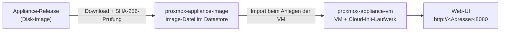

# Kamerplanter Infrastructure

Terraform-Module und fertige Konfigurationen, die die [Kamerplanter-Appliance](https://github.com/nolte/kamerplanter-appliance) als laufende Maschine bei einem Hosting-Anbieter bereitstellen. Proxmox VE ist das erste unterstützte Ziel; Hetzner Cloud und OVHcloud sind geplant.

!!! warning "Status: Planung"
    Die Proxmox-VE-Module sind bisher nur gegen einen simulierten Provider getestet. `kamerplanter-appliance` hat noch kein Release veröffentlicht, Dateinamen der Images und Einstellungen für den ersten Start können sich also noch ändern.

## Wo anfangen

| Du willst … | Lies |
|---|---|
| die Appliance auf deinem Proxmox-VE-Node betreiben | [Auf Proxmox VE bereitstellen](getting-started/proxmox.md) |
| eine feste Adresse, ein VLAN oder DNS-Server setzen | [Netzwerk einrichten](guides/network.md) |
| die Module aus deinem eigenen Terraform-Code nutzen | [Module in der eigenen Konfiguration nutzen](guides/own-configuration.md) |
| auf ein neues Appliance-Release wechseln, die VM vergrößern oder entfernen | [Aktualisieren, vergrößern, entfernen](guides/lifecycle.md) |
| ein fehlgeschlagenes `terraform apply` beheben | [Fehlerbehebung](guides/troubleshooting.md) |
| alle Eingaben und Ausgaben nachschlagen | [Referenzen](references/index.md) |

## Was entsteht

Das Image-Modul lädt ein Release-Image in einen Datastore deines Nodes. Das VM-Modul legt daraus eine virtuelle Maschine an und übergibt Hostname, SSH-Schlüssel und Netzwerkeinstellungen. Nach dem ersten Start aktualisiert sich die Appliance selbst; Terraform ersetzt die laufende VM nie wegen eines neueren Images.
