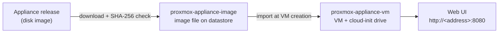

# Kamerplanter Infrastructure

Terraform modules and ready-to-use configurations that bring the [Kamerplanter appliance](https://github.com/nolte/kamerplanter-appliance) up as a running machine at a hosting provider. Proxmox VE is the first supported target; Hetzner Cloud and OVHcloud are planned.

!!! warning "Status: planning"
    The Proxmox VE modules are tested against a mocked provider only. `kamerplanter-appliance` has not published a release yet, so image file names and first-boot settings may still change.

## Where to start

| You want to … | Read |
|---|---|
| Run the appliance on your Proxmox VE node | [Deploy on Proxmox VE](getting-started/proxmox.md) |
| Set a static address, VLAN, or DNS servers | [Configure the network](guides/network.md) |
| Use the modules from your own Terraform code | [Use the modules in your configuration](guides/own-configuration.md) |
| Move to a new appliance release, resize, or remove the VM | [Update, resize, and remove](guides/lifecycle.md) |
| Fix a failed `terraform apply` | [Troubleshooting](guides/troubleshooting.md) |
| Look up every input and output | [References](references/index.md) |

## What gets created

The image module downloads a release image onto a datastore of your node. The VM module creates a virtual machine from it and hands over hostname, SSH keys, and network settings. After the first boot the appliance updates itself; Terraform never replaces the running VM because of a newer image.
